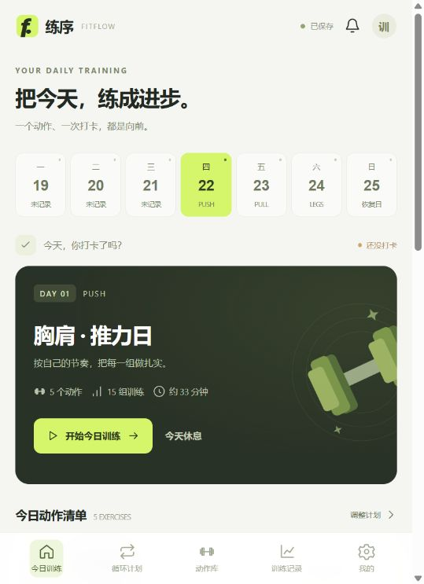

# 练序 FITFLOW

手机优先的个人健身网站。包含每日计划、训练打卡、未完成顺延、循环分化、动作库、逐组记录、休息计时和训练历史。



## 现在如何打开

- 电脑：<http://localhost:3210/>
- 同一 Wi-Fi 下的手机：使用启动日志中输出的 `LAN` 地址，例如 `http://你的电脑局域网IP:3210/`。

电脑需要保持开机，Node 服务需要持续运行。手机首次访问若失败，请检查是否连接同一个非访客 Wi-Fi、是否存在 AP 隔离，以及 Windows 防火墙是否允许 Node.js 在专用网络接收入站连接。本项目没有自动修改系统防火墙。

## 启动

环境：Node.js 22.9 或更新版本。没有第三方运行依赖，无需执行 npm install，也无需前端构建。

```powershell
cd 路径\fitflow
npm start
```

也可以在 PowerShell 中执行 `./start-local.ps1`，或使用 `node server.mjs`。`npm start` 会读取存在的 `.env`。默认监听 `0.0.0.0:3210`，控制台会输出电脑和局域网地址。按 Ctrl+C 停止前台服务。

开发时使用 `npm run dev`，Node 会监测服务端文件变化。前端 HTML / CSS / JS 由服务直接读取，修改后刷新页面即可。不要让多个进程同时使用同一个数据目录。

## 已实现

- **今日训练**：每天显示「今天，你打卡了吗？」、本周安排、当天动作和每周目标。首次使用没有伪造历史数据。
- **分化循环**：全身、二分化、三分化、四分化、五分化、六分化模板；支持 1–30 天自定义循环。可以添加、删除、前移、后移训练日，插入恢复日。
- **自定义项目**：内置 55 个健身房常用动作，覆盖胸、背、肩、腿、臀、手臂、核心和有氧。支持部位 / 器械筛选、搜索、自定义动作、名称与笔记编辑。
- **每日规划**：动作可自由增删和排序；每个动作设置组数、次数或时长、重量、组间休息与备注。模板用于排程起点，重量默认为 0，按实际训练自行设置。
- **训练记录**：逐组记录重量和次数，支持按秒 / 分钟记录；勾选完成、暂停 / 恢复训练计时、组间倒计时、上次训练重量参考、训练感受。
- **每日打卡**：全部完成或显式确认部分完成；一天只打卡一次。当前计划当天最近一次打卡可撤销，原有组记录恢复。
- **自动顺延**：未打卡的训练不会跳过，即使几天没打开也保留当前训练和已完成的组。无需让浏览器后台运行，下一次请求会按设定时区更新日期。
- **休息安排**：既可在循环中设置恢复日，也可设置每周固定休息日。固定休息日不消耗训练循环。主动选择今天休息后可随时恢复。
- **记录与统计**：月历、打卡明细、90 天热力图、每周目标、累计训练次数 / 时长 / 训练量、体重记录和趋势。
- **服务端存储**：手机和电脑访问同一服务，共享同一份个人数据；原子写入、上一版本文件备份、版本冲突检查，避免其他设备静默覆盖。
- **备份迁移**：导出 / 导入 JSON；导入前检查版本、结构、数值范围和训练引用。自定义动作后续编辑不会修改已经打卡的历史快照。
- **手机体验**：底部导航、大触控目标、窄屏布局、安全区域、底部弹窗、数字键盘、PWA 清单和图标。在 HTTPS / localhost 可缓存界面并离线查看最近读取的数据；离线状态不允许写入。
- **私人访问保护**：可配置服务端访问密码、HttpOnly Cookie、登录尝试限速、同源写入校验和主机名白名单。生产模式强制配置至少 12 位密码。

## 顺延与循环规则

假设循环是「推 → 拉 → 腿 → 恢复」。

1. 周一没有完成「推」的打卡，周二仍然是「推」，已记录的组会保留。
2. 周二完成「推」，周三进入「拉」。一天仅推进一次，不会因为重复点击跳过训练。
3. 循环中的恢复日需要点「完成恢复打卡」，次日继续下一项。恢复打卡不计入每周训练目标。
4. 设置每周日固定休息后，周日不会消耗循环中的一天；周一继续尚未完成的训练。
5. 「今天休息」会保留当前进度；「今天还是想练」可在当天恢复。
6. 周历未来日期是预计安排，假设此前每天按时打卡。实际顺延后会重新计算。
7. 保存新计划会创建一个新的计划版本，从第 1 天开始；历史保留。今天已经打卡则明天开始，未打卡的当前进度会被替换，界面会在有训练进度时提醒。

默认使用中国标准时间 `Asia/Shanghai`。跨天时，仍在运行的训练计时在前一天午夜暂停，避免隔几天打开后把整段离线时间都统计成训练时间。固定休息日、主动休息和漏打卡都不会伪造训练记录。

## 提醒的范围

每天打开网页会显示打卡状态；达到设置的提醒时间且网页处于打开状态时，会显示页面内提醒。用户可手动允许浏览器通知。**没有实现关掉网页或手机锁屏后的可靠后台推送**；这需要额外的 Web Push 服务、订阅管理及 HTTPS。此版本不会声称已启用后台推送。

## 数据保存在哪里

默认在项目 `data/` 目录：

- `state.json`：当前完整数据。
- `state.previous.json`：最近一次成功保存前的数据。

每次写入先写临时文件并同步到磁盘，再替换主文件。启动时若发现主文件不合法，会报错退出，不会静默覆盖旧数据。需要手动恢复上一版本时，先停止服务、保留两份原文件，再把有效备份复制为 `state.json`。

这是**单人、单服务实例**的应用。不要使用 PM2 cluster、多副本容器或多个进程共享同一个目录。以后若需要多人独立账户、大量并发或团队功能，应迁移为数据库事务与用户体系。

本地缓存只用于断网时查看最近读取的数据；服务器是权威数据源。离线修改不加入隐形队列，需联网后重试。不同设备同时写入发生版本冲突时，应用刷新服务器状态并提示重新操作。

## 后续部署云服务器：Docker Compose + HTTPS

项目已附带 `Dockerfile`、`compose.yaml` 和 `Caddyfile`。本次没有发布到任何云服务，也没有申请证书或域名。下面配置供后续部署使用。

前提：Linux 云服务器已安装 Docker / Docker Compose，有一个解析到该服务器的域名，80/443 端口允许访问。

1. 上传整个项目源代码，排除本地 `.env` 和 `data/`。
2. 复制 `.env.example` 为 `.env`，设置自己的域名和强随机密码。不要使用示例域名或示例密码。可用 `node -e "console.log(require('crypto').randomBytes(24).toString('hex'))"` 在自己的终端生成密码，妥善保存。

```dotenv
DOMAIN=你的真实域名
APP_PASSWORD=至少12位的私人随机密码
```

3. 启动：

```sh
docker compose up -d --build
docker compose logs --tail=50
```

Caddy 会为已正确解析的域名提供 HTTPS 并代理到应用。应用容器的 3210 端口不直接暴露到公网；生产密码、允许主机名与 Secure Cookie 由 Compose 配置。证书与训练数据分别保存在命名卷中，容器重建不丢失数据。**不要执行 `docker compose down -v`，该参数会删除数据卷。**

4. 打开自己的 HTTPS 域名，输入 `.env` 设置的私人访问密码。
5. 在本地网站「我的设置 → 导出备份」，再到云端「我的设置 → 导入备份」，迁移所有计划和记录。手机以后直接使用云端域名，无需保持这台电脑开机。
6. 用 Safari / Chrome 添加到主屏幕。

更新代码后再执行 `docker compose up -d --build`。建议定期通过页面导出备份。容器重启会让原有登录失效，重新输入密码即可，训练数据不受影响。

### 不使用 Docker

可安装 Node.js 22.9+，设置 `NODE_ENV=production`、`APP_PASSWORD`、`ALLOWED_HOSTS`、`COOKIE_SECURE=true`，用 systemd / PM2 的**单进程模式**托管 `node server.mjs`，由已有的 Nginx / Caddy 代理 HTTPS。反向代理需保留真实 `Host`，并在 `ALLOWED_HOSTS` 中列出实际域名。`DATA_DIR` 可指定持久化目录。

## 验证

```sh
npm run check
npm test
```

测试包含漏打卡多天顺延、时区跨天、恢复日循环、固定休息日、部分打卡确认、重复打卡拦截、撤销恢复、计划变更与历史快照、备份校验、服务重启后的磁盘持久化、并发版本冲突、登录与退出、同源校验和静态资源。

目前 27 项自动检查通过。另有使用合成 DOM 的页面模板渲染测试，可发现页面 JavaScript 异常。

已在内置浏览器完成真实页面检查：桌面布局、手机窄屏布局、开始训练、记录重量与次数、勾选完成、组间计时、暂停与刷新后保留、部分完成确认、打卡后推进循环、分化模板切换、添加动作、保存计划、自定义动作搜索和体重记录。测试使用独立数据目录，没有向正式数据写入测试记录。真实手机硬件和移动系统通知尚未验证，Docker 配置未在云服务器执行。

## 文件结构

```text
fitflow/
  public/          手机界面、样式、动作模板、共享日期逻辑与 PWA
  domain.mjs       训练状态、顺延、打卡、备份验证
  server.mjs       HTTP API、登录、静态资源、原子文件存储
  data/            个人数据（不要提交到 Git）
  test/            核心规则、HTTP 集成、页面模板测试
  Dockerfile       单进程 Node 容器
  compose.yaml     应用、HTTPS 代理与持久化卷
  Caddyfile        HTTPS 反向代理
  .env.example     配置示例
  start-local.ps1  Windows 启动脚本
```
